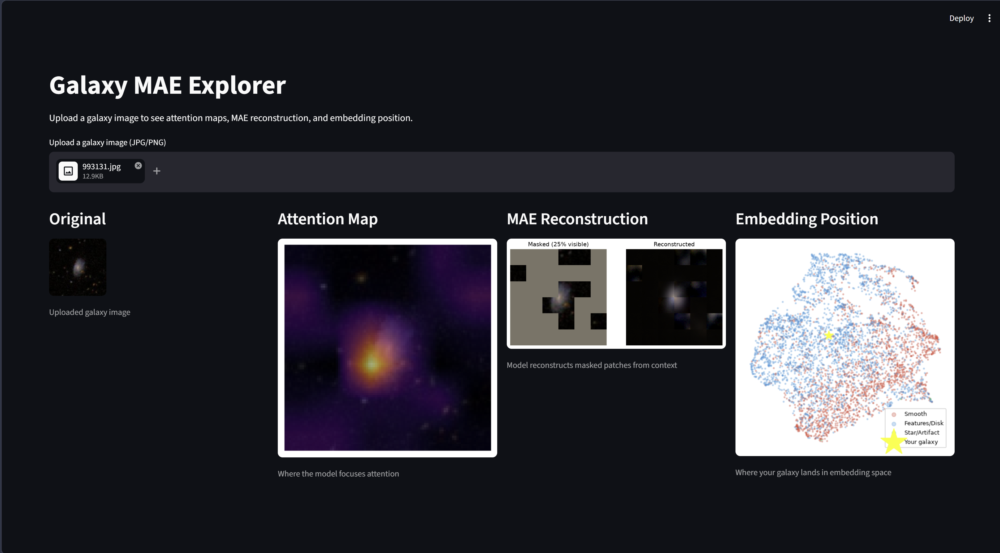
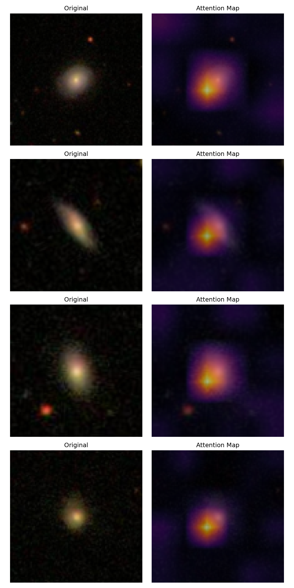
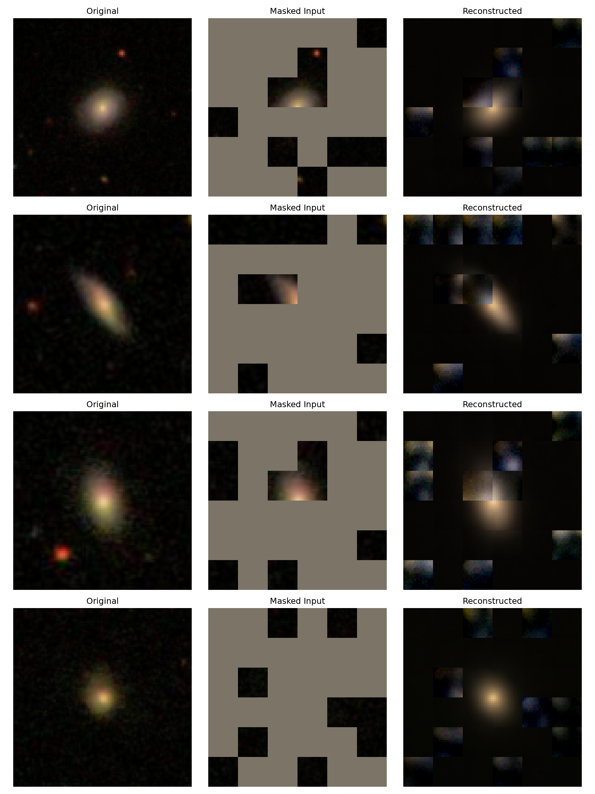
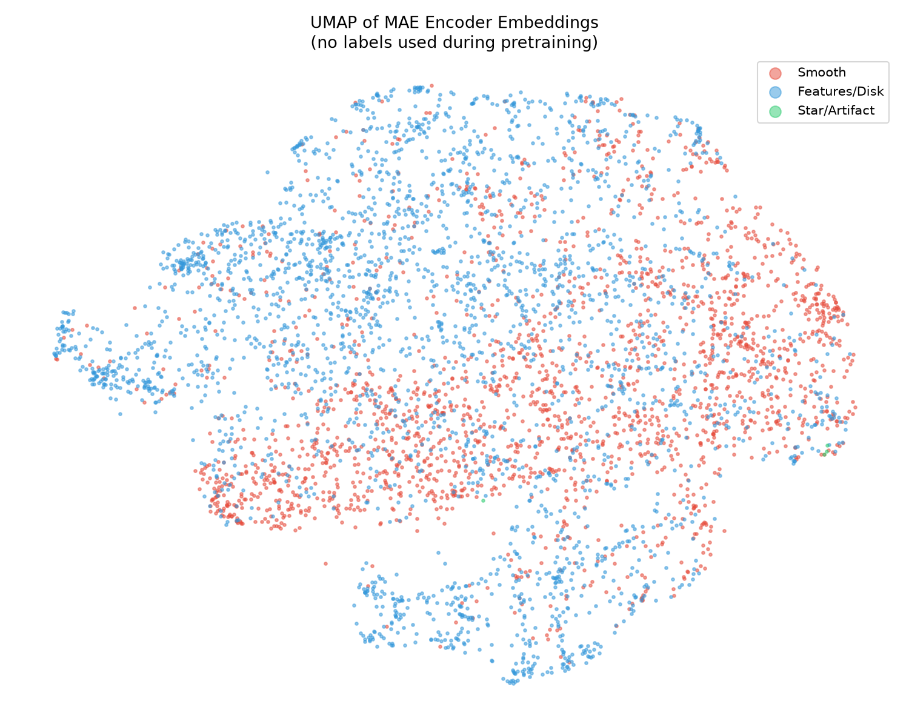

# Galaxy MAE — Self-Supervised ViT on Galaxy Zoo

A Vision Transformer (ViT) trained from scratch using Masked Autoencoders (MAE) on the Galaxy Zoo dataset, with a Streamlit app for interactive exploration.



---

## Results

| Method | Labels Used | Accuracy |
|--------|------------|----------|
| SSL (MAE pretrain) + Linear Probe | 100% | **81.00%** |
| SSL (MAE pretrain) + kNN | 100% | 78.73% |
| Supervised ViT from scratch | 20% | 79.06% |

**Key finding:** MAE-pretrained encoder with a frozen linear layer matches a fully supervised ViT trained on 5× more labeled data — demonstrating the value of self-supervised pretraining in low-label regimes.

---

## What's Inside

- **ViT from scratch** — patch embedding, multi-head self-attention, transformer blocks, positional embeddings — no HuggingFace
- **MAE pretraining** — 75% random patch masking, encoder-only forward pass, lightweight decoder, MSE loss on masked patches only
- **Linear probe + kNN evaluation** — frozen encoder features evaluated on Galaxy Zoo morphology labels
- **Supervised baseline** — same ViT trained end-to-end on 20% of labels for direct comparison
- **Visualizations** — attention maps, MAE reconstructions, UMAP embedding space
- **Streamlit app** — upload any galaxy image, see attention map, reconstruction, and embedding position in real time

---

## Visualizations

**Attention Maps** — the model learns to focus on galactic cores without any supervision:



**MAE Reconstructions** — reconstructing 75% masked patches from 25% visible context:



**UMAP** — galaxy embeddings cluster by morphology with no labels used during pretraining:



---

## Setup

```bash
conda create -n galaxy-mae python=3.11
conda activate galaxy-mae
pip install torch torchvision pillow pandas scikit-learn matplotlib umap-learn streamlit
```

Download the [Galaxy Zoo dataset](https://www.kaggle.com/c/galaxy-zoo-the-galaxy-challenge/data) and update paths in `configs/config.py`.

---

## Training

**MAE Pretraining (run on Kaggle GPU):**
```bash
# paste kaggle_pretrain.py into a Kaggle notebook with GPU enabled
# checkpoint saves to /kaggle/working/mae_epochN.pth
```

**Supervised Baseline (run on Kaggle GPU):**
```bash
# paste kaggle_supervised.py into a Kaggle notebook with GPU enabled
```

---

## Evaluation

```bash
# Linear probe + kNN
python train/probe.py

# Visualizations
python eval/visualize.py

# Precompute embeddings for Streamlit app
python eval/save_embeddings.py
```

---

## Streamlit App

```bash
streamlit run app/app.py
```

Upload any galaxy JPG to see:
- Attention heatmap overlay
- MAE reconstruction (masked input → predicted output)
- Embedding position on UMAP scatter plot

---

## Project Structure

```
VIT-Galaxyzoo/
├── models/
│   ├── vit.py          # ViT backbone (patch embedding, attention, encoder)
│   └── mae.py          # MAE wrapper (masking, decoder, loss)
├── data/
│   └── dataset.py      # Galaxy Zoo dataloader
├── train/
│   ├── pretrain.py     # MAE pretraining loop
│   ├── probe.py        # Linear probe + kNN evaluation
│   └── supervised.py   # Supervised ViT baseline
├── eval/
│   ├── visualize.py    # Attention maps, reconstructions, UMAP
│   └── save_embeddings.py
├── app/
│   └── app.py          # Streamlit app
├── configs/
│   └── config.py       # Hyperparameters
├── kaggle_pretrain.py  # Self-contained Kaggle pretraining notebook
└── kaggle_supervised.py
```

---

## Architecture

- **Image size:** 96×96
- **Patch size:** 16×16 → 36 patches per image
- **Encoder:** embed_dim=192, depth=6, heads=3 (~4M parameters)
- **Decoder:** dim=96, depth=4, heads=3 (lightweight, discarded after pretraining)
- **Mask ratio:** 75%
- **Training:** 75 epochs, AdamW lr=1.5e-4, batch=64
- **Final MAE loss:** ~0.02
